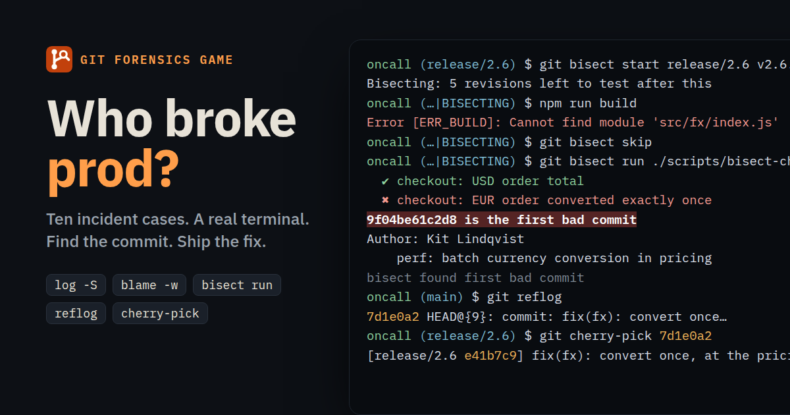
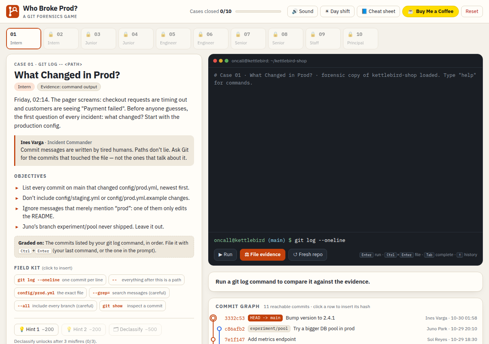
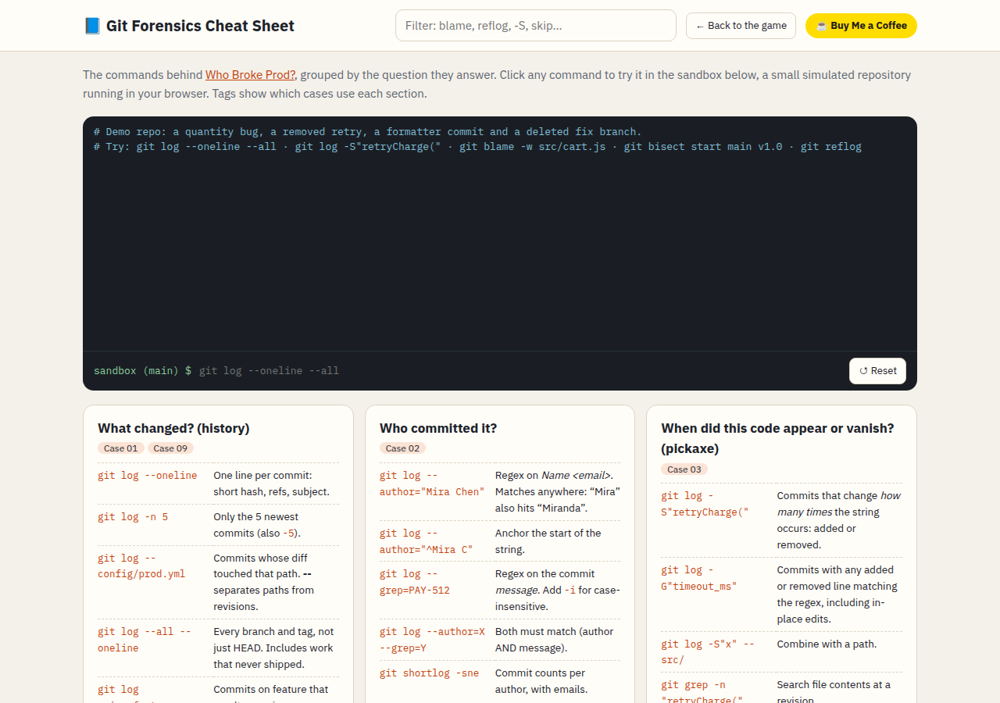

<div align="center">


# Who Broke Prod?

**Learn Git forensics by investigating a production outage in your browser.**

[](https://git.regexnoir.com/)
[](https://git.regexnoir.com/cheatsheet.html)
[](https://buymeacoffee.com/marginnotes)

[](https://github.com/wiks-sq/who-broke-prod/actions/workflows/verify.yml)
[](LICENSE)




</div>

## About

Most Git games teach branching with abstract diagrams. This one teaches **investigation**. You're on call, checkout is failing, and the answer is somewhere in a messy repository full of misleading commit messages, look-alike authors, formatter commits, broken builds and deleted branches.

You work in a real terminal backed by a Git simulator that runs in the browser. A live commit graph shows HEAD, branches and bisect marks as you go. Each case is graded on exact evidence: the commits your `git log` lists, the lines your `git blame` prints, or the state of the repository when you close the case.

It has no backend, no accounts and no build step. Progress is saved in your browser's `localStorage`.

## Features

- **10 cases, one concept each**, ending in a timed capstone that combines them.
- **A working terminal**: tab completion, history, `&&` chaining, clickable hashes, and a sandboxed Git covering log, show, diff, blame, bisect, reflog, branch, checkout/switch, reset, cherry-pick, shortlog and grep.
- **Decoys by design**: every case includes a commit that catches the most likely almost-right command, and a wrong answer gets a specific explanation.
- **Live feedback**: an evidence panel and case board update after every command, for free. Only filing evidence costs points.
- **Command explainer**: after each solve, your command is broken down flag by flag next to the reference answer.
- **Scoring and badges**: misfires, hints and speed affect your score. Seven commendations, plus a downloadable *Principal Investigator* badge.
- **[Git forensics cheat sheet](https://git.regexnoir.com/cheatsheet.html)**: a searchable reference with its own sandbox terminal.
- **Accessible**: Day, Night and High Contrast themes, keyboard-only play, screen-reader live regions and `prefers-reduced-motion` support.

## Screenshots

| Case console | Cheat sheet |
|---|---|
|  |  |

## The cases

| # | Case | Concept | Rank |
|---|---|---|---|
| 01 | What Changed in Prod? | `git log -- <path>` | Intern |
| 02 | Two Miras | `git log --author` | Intern |
| 03 | The Missing Retry | `git log -S` (pickaxe) | Junior |
| 04 | Line by Line | `git blame -L` | Junior |
| 05 | The Formatter Didn't Do It | `git blame -w` / `--ignore-rev` | Engineer |
| 06 | Halving the Haystack | `git bisect` | Engineer |
| 07 | Through the Broken Builds | `git bisect skip` / `run` (exit 125) | Senior |
| 08 | The Vanishing Hotfix | `git reflog` | Senior |
| 09 | Ship the Fix, Not the Feature | `git cherry-pick` | Staff |
| 10 | Who Broke Production? | Capstone: bisect + reflog + cherry-pick (timed) | Principal |

Cases unlock in order. Answers are deliberately not published here, so no spoilers.

## How to play

1. Read the briefing, the mentor's note and the objectives on the left.
2. Type commands in the terminal and press <kbd>Enter</kbd>. Running commands is free.
3. Watch the evidence panel (or case board) and the commit graph react.
4. Press <kbd>Ctrl</kbd>/<kbd>⌘</kbd> + <kbd>Enter</kbd> to **file evidence** or **close the case**. Wrong answers cost 100 points.

Stuck? Hints cost 200 points each. After three misfires you can declassify the reference answer (−500).

## Run it locally

```bash
git clone https://github.com/wiks-sq/who-broke-prod.git
cd who-broke-prod
python3 -m http.server 8000
```

Then open <http://localhost:8000>. Opening `index.html` directly also works. React, Babel and fonts load from CDNs, so the first load needs an internet connection.

## Development

- `engine.js` is the Git simulator. The game, the cheat sheet and the verifier all share it.
- `index.html` holds the UI (React, compiled in the browser by Babel) and the case data.
- `cheatsheet.html` is plain HTML, CSS and JavaScript.

To check that every case's reference answer passes, documented alternatives pass and known near-misses are rejected:

```bash
node tools/verify-cases.js
```

CI runs the same check on every push and pull request. See **[docs/DEVELOPMENT.md](docs/DEVELOPMENT.md)** for the engine internals, case data schema, scoring rules and how to add a case.

### Tech stack

| | |
|---|---|
| Engine | Hand-written Git simulator (`engine.js`), plain JS, runs in the browser and in Node |
| UI | React 18 (UMD) + Babel standalone, no bundler |
| Styling | Hand-written CSS with custom properties for themes |
| Fonts | IBM Plex Sans, IBM Plex Mono (Google Fonts) |
| Hosting | Static files on Apache at git.regexnoir.com |

## Contributing

Issues and pull requests are welcome: case ideas, clearer explanations, engine fidelity fixes, accessibility improvements or bug reports.

1. Fork the repo and create a branch.
2. Make your change. If you touch `engine.js` or case data, run `node tools/verify-cases.js`.
3. Open a pull request describing what changed and why.

Please don't post case solutions in public issues.

## Support

If the game made `git bisect` click for you, you can [buy me a coffee](https://buymeacoffee.com/marginnotes) ☕.

## License

[MIT](LICENSE). All people, companies and commits in the cases are fictional.
